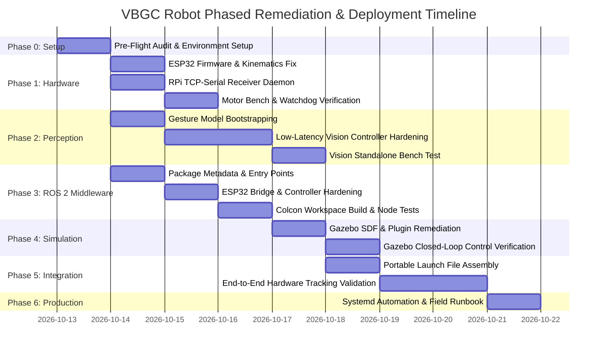

# Phase-Wise Implementation Plan: VBGC Robot Repair & Deployment

> **Target System:** Vision-Based Gesture-Controlled Person-Following Robot  
> **Reference Guide:** [`SYSTEM_REPAIR_AND_DEPLOYMENT_GUIDE.md`](./SYSTEM_REPAIR_AND_DEPLOYMENT_GUIDE.md)  
> **Repository Root:** `/Users/dakshabordekar/VisionBasedGestureControlledPersonFollowingRobot`  
> **Status:** Ready for Execution  

---

## 1. Executive Implementation Roadmap



---

## 2. Phase Breakdown Matrix

| Phase | Focus Area | Key Fixes Addressed | Critical Artifacts / Files | Gate / Exit Criteria | Risk Level |
| :--- | :--- | :--- | :--- | :--- | :--- |
| **Phase 0** | Pre-Flight Audit & Toolchain Setup | Toolchain prerequisites, user permissions | Virtual env, `colcon`, serial access, model weights | `python3` venv active with all packages; `/dev/ttyUSB0` rw permission confirmed | Low |
| **Phase 1** | Low-Level Hardware & Actuation | **BUG-01**, **BUG-07**, Fix 1, Fix 2 | `hardware/esp32/motor_controller/motor_controller.ino`, `hardware/pi/pi_cmdvel_receiver.py` | Bench test: differential PWM math verified; watchdog halts motors within 500ms | High |
| **Phase 2** | Perception Engine & Cold Bootstrapping | **BUG-03**, **BUG-04**, **BUG-05**, **BUG-08**, Fix 5, Fix 6 | `vision/train_gesture_model.py`, `vision/cc_ll.py` | `cc_ll.py` runs standalone on camera 0; closed-fist pairs target; 63D feature model serializes | High |
| **Phase 3** | ROS 2 Middleware & Node Registration | **BUG-06**, Fix 3, Fix 7 | `ros2_ws/src/vbgc_robot/package.xml`, `setup.py`, `esp32_motor_bridge.py` | `colcon build` succeeds with 0 warnings; all 7 console scripts executable via `ros2 run` | Medium |
| **Phase 4** | Simulation Parity & Gazebo Hardening | Fix 8 | `worlds/rover_world.sdf`, `launch/simulation.launch.py` | Rover model spawns in Gazebo; responds to simulated target pose tracking | Medium |
| **Phase 5** | Unified Launch & Full System Integration | **BUG-02**, Fix 4, Fix 10 | `ros2_ws/src/vbgc_robot/launch/full_system.launch.py` | One-command launch (`ros2 launch`); person pairing, `FOLLOW`, `STOP`, `DOCK` gestures verified | High |
| **Phase 6** | Operational Hardening & Automation | Fix 9 | `apply_fixes.py`, `/etc/systemd/system/vbgc-receiver.service` | Autonomous daemon startup on Pi; automated patch regression test passes | Low |

---

## 3. Detailed Phase Specifications

### Phase 0: Pre-Flight Audit & Toolchain Setup

#### Objective
Ensure host system and target hardware have compatible runtime environments, required packages, and non-blocking device permissions.

#### Tasks
1. **Host Environment Verification:**
   - Verify Python 3.10+ installation.
   - Verify ROS 2 Humble or Jazzy workspace sourcing.
   - Verify serial communication permissions for the current user:
     ```bash
     sudo usermod -a -G dialout $USER
     # On Linux, verify group membership:
     groups | grep dialout
     ```
2. **Python Virtual Environment & Dependencies:**
   - Activate or initialize the dedicated virtual environment:
     ```bash
     cd /Users/dakshabordekar/VisionBasedGestureControlledPersonFollowingRobot
     python3 -m venv .venv
     source .venv/bin/activate
     pip install --upgrade pip
     pip install opencv-python mediapipe ultralytics scikit-learn joblib pyserial numpy
     ```
3. **Model Assets Validation:**
   - Confirm presence of `vision/hand_landmarker.task` and `vision/yolo11n.pt`. If missing, download official pre-trained weights.

#### Verification & Exit Gate
```bash
python3 -c "import cv2, mediapipe, ultralytics, sklearn, serial; print('All core vision & serial libraries imported successfully.')"
```
- **Pass Criteria:** Zero import errors.

---

### Phase 1: Low-Level Hardware & Actuation Layer

#### Objective
Repair the non-functional ESP32 firmware (**BUG-01**) and establish the Raspberry Pi command velocity receiver daemon (**BUG-07**).

#### Tasks
1. **ESP32 Differential Drive Firmware Implementation (Fix 1):**
   - Replace empty `loop()` in `hardware/esp32/motor_controller/motor_controller.ino`.
   - Implement:
     - 20 kHz LEDC hardware PWM on pins 25 (ENA) and 17 (ENB).
     - Non-blocking ASCII serial parser for `<linear> <angular>\n`.
     - Inverse kinematics: $v_{\text{left}} = v - \frac{\omega L}{2}$, $v_{\text{right}} = v + \frac{\omega L}{2}$.
     - Static friction deadzone compensation ($\text{PWM}_{\min} = 65$).
     - 500 ms command watchdog failsafe to prevent runaway conditions.
2. **Flash ESP32 Firmware:**
   ```bash
   arduino-cli compile --fqbn esp32:esp32:esp32 hardware/esp32/motor_controller
   arduino-cli upload -p /dev/ttyUSB0 --fqbn esp32:esp32:esp32 hardware/esp32/motor_controller
   ```
3. **Raspberry Pi TCP Bridge Receiver Daemon (Fix 2):**
   - Deploy `hardware/pi/pi_cmdvel_receiver.py`.
   - Configure non-blocking TCP socket server on port 5000 with UART pass-through to `/dev/ttyUSB0`.
   - Setup systemd service unit `/etc/systemd/system/vbgc-receiver.service`.

#### Verification & Exit Gate (Protocol A from Guide)
1. **Serial Packet Bench Test:**
   - Open serial terminal at 115200 baud.
   - Send: `0.200 0.000\n` $\to$ Motors spin forward.
   - Send: `0.000 0.500\n` $\to$ Rover spins right in place.
   - Pause commands $\to$ Motors halt within 500ms with watchdog warning.

---

### Phase 2: Perception Engine & Cold Bootstrapping

#### Objective
Eliminate startup crashes caused by hardcoded network streams (**BUG-03**), missing gesture models (**BUG-04**), hardcoded python interpreter paths (**BUG-05**), and IPC connection churn (**BUG-08**).

#### Tasks
1. **Gesture Model Trainer & Synthetic Bootstrapper (Fix 6):**
   - Deploy updated `vision/train_gesture_model.py`.
   - Implement synthetic feature generator for clean clones without CSV data.
   - Calculate open-set k-NN distance rejection thresholds ($k=5$, 95th percentile with tolerance multiplier).
   - Generate initial `vision/gesture_model.pkl`:
     ```bash
     cd vision
     python3 train_gesture_model.py
     ```
2. **Resilient Low-Latency Vision Controller (Fix 5):**
   - Deploy updated `vision/cc_ll.py`.
   - Implement `ResilientCameraStream` with automatic fallback:
     - Attempts network MJPEG stream first $\to$ auto-reverts to `/dev/video0` (USB camera) if unreachable within 3.0s.
   - Implement geometric `is_closed_fist()` invariant for target pairing without requiring an ML model.
   - Implement `PersistentSocketClient` for `/tmp/vbgc_target.sock` and `/tmp/vbgc_gesture.sock`.
   - Route interactive calibration execution via `sys.executable`.

#### Verification & Exit Gate
```bash
cd vision
python3 cc_ll.py --camera 0
```
- **Pass Criteria:**
  - GUI window opens without crashing even if model or network camera is absent.
  - Presenting a closed fist for 3 seconds displays green progress bar and locks `TARGET ID`.
  - Pressing `C` triggers calibration mode and saves fresh gesture samples.

---

### Phase 3: ROS 2 Middleware & Node Registration

#### Objective
Remediate ROS 2 build configuration (**BUG-06**), register missing executables, and harden hardware bridge nodes (Fix 3, Fix 7).

#### Tasks
1. **Metadata & Manifest Repair (Fix 3):**
   - Update `ros2_ws/src/vbgc_robot/package.xml`:
     - Add `<depend>geometry_msgs</depend>`.
     - Add `<exec_depend>ros_gz_sim</exec_depend>` and `<exec_depend>ros_gz_bridge</exec_depend>`.
   - Update `ros2_ws/src/vbgc_robot/setup.py`:
     - Register `laptop_cmdvel_bridge` and `target_publisher` entry points under `console_scripts`.
2. **Bridge Node Hardening (Fix 7):**
   - Update `ros2_ws/src/vbgc_robot/vbgc_robot/esp32_motor_bridge.py` with runtime parameters (`serial_port`, `baud_rate`, `command_timeout`) and auto-reconnect logic.
   - Parameterize `following_controller.py` with `desired_distance`, `max_linear_speed`, `max_angular_speed`.
3. **Workspace Build:**
   ```bash
   cd ros2_ws
   rosdep install --from-paths src --ignore-src -r -y
   colcon build --symlink-install
   source install/setup.bash
   ```

#### Verification & Exit Gate
```bash
source ros2_ws/install/setup.bash
ros2 pkg executables vbgc_robot
```
- **Pass Criteria:** Output lists all 7 executables:
  - `camera_target_publisher`
  - `esp32_motor_bridge`
  - `following_controller`
  - `gesture_publisher`
  - `laptop_cmdvel_bridge`
  - `simulated_target`
  - `target_publisher`

---

### Phase 4: Simulation Parity & Gazebo Validation

#### Objective
Ensure the full robot model, sensor plugins, and kinematic controller execute reliably in Gazebo simulation before physical robot trials (Fix 8).

#### Tasks
1. **Gazebo World & Plugin Remediation (Fix 8):**
   - Update `ros2_ws/src/vbgc_robot/worlds/rover_world.sdf` with required Gazebo Harmonic plugins:
     - `gz-sim-physics-system`
     - `gz-sim-user-commands-system`
     - `gz-sim-scene-broadcaster-system`
     - `gz-sim-contact-system`
2. **Launch & Simulation Parity Test (Protocol B):**
   - Launch Gazebo simulation:
     ```bash
     cd ros2_ws
     source install/setup.bash
     ros2 launch vbgc_robot full_system.launch.py use_sim:=true
     ```
   - Publish simulated target coordinate and `FOLLOW` command:
     ```bash
     ros2 topic pub /gesture_command std_msgs/msg/String "{data: 'FOLLOW'}" --once
     ros2 run vbgc_robot simulated_target
     ```

#### Verification & Exit Gate
- **Pass Criteria:**
  - Rover spawns at `(0, 0, 0.15)` in Gazebo without physics explosion.
  - Rover steers and drives toward the simulated target, maintaining a 1.0m standoff distance.

---

### Phase 5: Unified Launch & Full System Integration

#### Objective
Deploy portable universal launch file (**BUG-02**, Fix 4) and conduct end-to-end vision-to-actuation person tracking tests (Protocol C).

#### Tasks
1. **Portable Launch File Integration (Fix 4):**
   - Replace `ros2_ws/src/vbgc_robot/launch/full_system.launch.py`.
   - Remove hardcoded home directories and python paths.
   - Add dynamic repo root discovery (`find_repo_root()`).
   - Wire launch configurations: `use_sim`, `serial_port`, `baud_rate`, `camera_url`, `python_exec`.
2. **Re-build & End-to-End System Execution:**
   ```bash
   cd ros2_ws
   colcon build --symlink-install
   source install/setup.bash
   ros2 launch vbgc_robot full_system.launch.py camera_url:=0 serial_port:=/dev/ttyUSB0
   ```
3. **Execution of Live Validation Protocol:**
   - Step in front of camera $\to$ closed fist hold 3.0s $\to$ Target locked (`TARGET ID`).
   - Give `FOLLOW` gesture $\to$ Rover tracks person walking forward, backward, left, right.
   - Give `STOP` gesture $\to$ Rover halts within 100ms.
   - Give `DOCK` gesture $\to$ Target released, rover reverts to IDLE.

#### Verification & Exit Gate
- **Pass Criteria:** Full protocol completes with zero crashes, zero socket disconnects, and verified motor motion.

---

### Phase 6: Operational Hardening, Automation & Documentation

#### Objective
Ensure maintainability, repeatable deployments, and disaster recovery procedures (Fix 9).

#### Tasks
1. **Automated Repair Script Deployment (Fix 9):**
   - Commit and verify `apply_fixes.py` at repository root.
   - Test automated file backup (`.bak`) and patch verification.
2. **Documentation & Service Setup:**
   - Enable Raspberry Pi auto-start daemon (`vbgc-receiver.service`).
   - Document operational runbook and safety checklist for battery / field operation.

---

## 4. Risk & Rollback Management

| Risk Event | Severity | Probability | Mitigation Strategy | Rollback Procedure |
| :--- | :--- | :--- | :--- | :--- |
| ESP32 fails to flash over serial | High | Low | Verify baud rate (115200) and hold BOOT button during flash. | Revert to previous firmware binary or factory test sketch. |
| Camera frame rate drops below 15 FPS | Medium | Medium | Downscale camera resolution to 640x480; run YOLO inference on ByteTrack with lower input size (320). | Set `--camera 0` to fallback index or run without YOLO person tracking. |
| Socket connection refused between vision & ROS 2 | Medium | Low | Ensure ROS 2 target/gesture publisher nodes start before or concurrently with `cc_ll.py`. | Check `/tmp/vbgc_*.sock` permissions; clean stale socket files (`rm -f /tmp/vbgc_*.sock`). |
| Motor jitter or erratic speed commands | High | Low | Confirm ultrasonic PWM frequency (20 kHz) and deadzone clamp (65). | Immediately kill ROS 2 bridge; watchdog halts motors in 500ms. |

---

## 5. Definition of Done (DoD)

The system repair and deployment is officially **DONE** when:
- [ ] All 8 root-cause bugs (**BUG-01** to **BUG-08**) are resolved and verified.
- [ ] ESP32 executes differential drive kinematics with 500ms watchdog failsafe.
- [ ] ROS 2 workspace builds cleanly with `colcon build --symlink-install` without errors or warnings.
- [ ] Vision controller boots cold without pre-existing `gesture_model.pkl` and self-bootstraps.
- [ ] Gazebo simulation verifies 1.0m standoff tracking against simulated target.
- [ ] Hardware integration demonstrates target pairing, `FOLLOW`, `STOP`, and `DOCK` gestures live.
