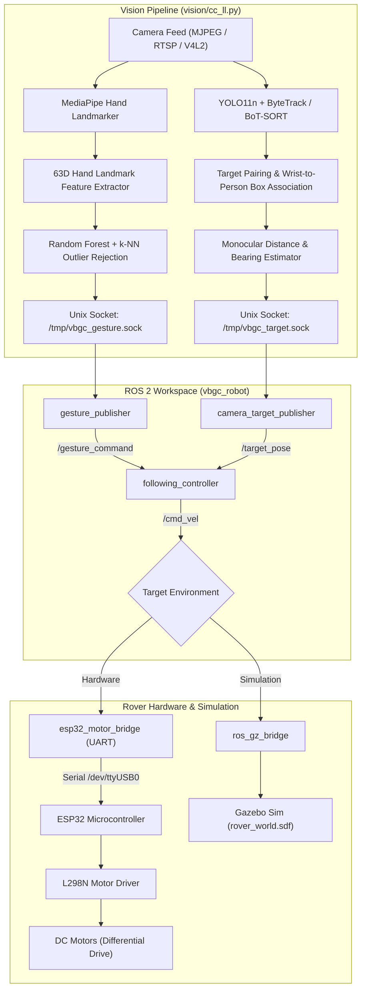
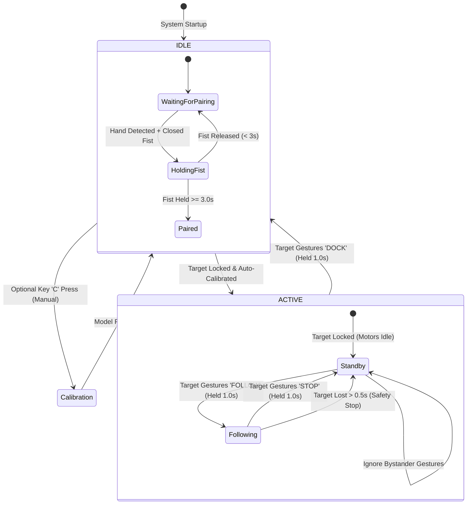

# Vision-Based Gesture-Controlled Person-Following Robot

An autonomous, vision-guided differential drive mobile robot that pairs with a specific human user, tracks them in real time, and responds to dynamic hand gestures for hands-free navigation. Built with **ROS 2**, **YOLO11**, **ByteTrack / BoT-SORT**, **MediaPipe**, and an **ESP32** hardware motor controller.

---

## Table of Contents

- [Overview](#overview)
- [Key Features](#key-features)
- [System Architecture](#system-architecture)
- [State Machine & Interaction Flow](#state-machine--interaction-flow)
- [Repository Structure](#repository-structure)
- [Prerequisites & Dependencies](#prerequisites--dependencies)
- [Installation & Setup](#installation--setup)
- [Usage Guide](#usage-guide)
  - [1. Standalone Gesture Collection & Training](#1-standalone-gesture-collection--training)
  - [2. Running the Full System (Hardware + Vision + ROS 2)](#2-running-the-full-system-hardware--vision--ros-2)
  - [3. Running Gazebo Simulation](#3-running-gazebo-simulation)
  - [4. Standalone Vision Controller](#4-standalone-vision-controller)
- [Gesture Control System](#gesture-control-system)
- [ROS 2 Interface & Topics](#ros-2-interface--topics)
- [Hardware Architecture & Pinout](#hardware-architecture--pinout)
- [Tuning & Configuration](#tuning--configuration)
- [Troubleshooting](#troubleshooting)

---

## Overview

This project implements an end-to-end autonomous robotic platform capable of:
1. **Target Identification & Pairing**: Locking onto a designated person using a timed gesture handshake (3-second closed fist).
2. **Robust Human Tracking**: Tracking the paired target across camera frames using YOLO11 detection combined with ByteTrack/BoT-SORT tracking and OSNet ReID.
3. **Monocular 3D Pose Estimation**: Inferring target distance and bearing angle relative to the robot frame from 2D bounding box geometry.
4. **Gesture Command Recognition**: Classifying target gestures (`FOLLOW`, `STOP`, `DOCK`) with an open-set rejection boundary to ignore unauthorized bystanders or invalid hand poses.
5. **Differential Drive Control**: Driving physical motors via an ESP32 microcontroller or simulating robot dynamics inside Gazebo Sim.

---

## Key Features

- **Exclusive Target Locking**: Hand gestures are mapped to the bounding box of the interacting person. The robot ignores gestures from any other person in the frame.
- **Open-Set Rejection & Adaptive Thresholding**: A Random Forest classifier paired with a $k$-NN distance threshold rejects unseen or ambiguous hand poses instead of forcing false positives.
- **Low-Latency Vision Pipeline**: Threaded MJPEG client with atomic buffer swap for real-time video streaming from a Raspberry Pi camera over Wi-Fi.
- **Fail-Safe Operation**: Watchdog timers in both the ROS 2 controller (0.5s timeout) and ESP32 motor bridge ensure immediate rover stop if target lock or serial communication is lost.
- **Simulation & Physical Parity**: Identical ROS 2 control nodes and `/cmd_vel` interface run in both Gazebo physical simulation and on actual rover hardware.

---

## System Architecture



---

## State Machine & Interaction Flow



---

## Repository Structure

```text
VisionBasedGestureControlledPersonFollowingRobot/
├── hardware/
│   └── esp32/
│       ├── esp32_test/
│       │   └── esp32_test.ino            # Hardware serial sanity check
│       └── motor_controller/
│           └── motor_controller.ino      # Basic motor pin test
├── ros2_ws/
│   ├── motor_test.ino                    # L298N differential drive firmware
│   └── src/
│       └── vbgc_robot/
│           ├── CMakeLists.txt / setup.py # ROS 2 package configuration
│           ├── package.xml               # Package metadata & dependencies
│           ├── description/
│           │   └── rover.urdf.xacro      # Rover kinematics, links, DiffDrive plugin
│           ├── launch/
│           │   ├── full_system.launch.py # Launches vision, ROS2 nodes, and ESP32 bridge
│           │   └── simulation.launch.py  # Spawns rover in Gazebo simulator
│           ├── vbgc_robot/
│           │   ├── camera_target_publisher.py  # Ingests /tmp/vbgc_target.sock -> /target_pose
│           │   ├── gesture_publisher.py        # Ingests /tmp/vbgc_gesture.sock -> /gesture_command
│           │   ├── following_controller.py     # P-controller for distance/angle -> /cmd_vel
│           │   ├── esp32_motor_bridge.py       # Bridges /cmd_vel -> Serial UART /dev/ttyUSB0
│           │   ├── laptop_cmdvel_bridge.py     # Bridges /cmd_vel over TCP to Raspberry Pi
│           │   ├── target_publisher.py         # Socket-to-Pose translator
│           │   └── simulated_target.py         # Synthetic sinusoidal target for simulation
│           └── worlds/
│               └── rover_world.sdf       # Gazebo simulation world definition
└── vision/
    ├── botsort_reid.yaml                 # BoT-SORT tracker configuration
    ├── caliberation_controller.py        # Vision controller with calibration routines
    ├── camera_test.py                    # OpenCV webcam test
    ├── cc_ll.py                          # Main Low-Latency Vision + Gesture Controller
    ├── collect_gestures.py               # Dataset acquisition script for custom gestures
    ├── gesture_features.py               # 63D invariant feature extractor for 21 hand landmarks
    ├── gesture_prediction.py             # Standalone gesture classifier test
    ├── hand_landmarker.task              # MediaPipe Hand Landmarker pre-trained model
    ├── hand_tracking.py                  # Standalone MediaPipe hand visualizer
    ├── person_reid_test.py               # ReID evaluation with OSNet
    ├── person_tracker.py                 # Standalone YOLO11 tracker test
    ├── pose_landmarker_full.task         # MediaPipe Pose Landmarker model
    ├── recalibration_test.py             # Gesture recalibration test
    ├── simple_caliberation.py            # Streamlined calibration runner
    ├── target_lock_test.py               # Pose-to-hand association validation
    ├── threshold_*.py                    # Outlier rejection and threshold validation tools
    ├── train_gesture_model.py            # Random Forest training with adaptive rejection boundary
    └── yolo11n.pt                        # YOLO11 nano model weights
```

---

## Prerequisites & Dependencies

### Hardware
- Differential drive mobile robot chassis.
- 2x DC motors with encoders/gearboxes.
- L298N Dual H-Bridge Motor Driver.
- ESP32 Development Board.
- Raspberry Pi 4 / Camera (or USB Webcam mounted on robot).
- 12V Li-ion battery pack for motors + 5V power bank for compute.

### Software
- Ubuntu 22.04 LTS (or 24.04 LTS) with **ROS 2 Humble / Jazzy**.
- Gazebo Sim (`ros_gz_sim`, `ros_gz_bridge`).
- Python 3.10+ with standard ML stack.

### Python Libraries
Install Python dependencies into your environment:
```bash
pip install opencv-python mediapipe ultralytics scikit-learn joblib numpy pyserial
```
*Optional for ReID experiments:*
```bash
pip install torch torchvision torchreid
```

---

## Installation & Setup

### 1. Clone the Repository
```bash
git clone https://github.com/Aaryan-2294/VisionBasedGestureControlledPersonFollowingRobot.git
cd VisionBasedGestureControlledPersonFollowingRobot
```

### 2. Build the ROS 2 Workspace
```bash
cd ros2_ws
source /opt/ros/humble/setup.bash  # or jazzy
colcon build --symlink-install
source install/setup.bash
cd ..
```

### 3. Flash the ESP32 Firmware
1. Connect ESP32 via USB.
2. Open `ros2_ws/motor_test.ino` (or `hardware/esp32/motor_controller/motor_controller.ino`) in Arduino IDE.
3. Select board: `ESP32 Dev Module`.
4. Configure pins according to your hardware wiring (default: ENA: 25, IN1: 26, IN2: 27, IN3: 14, IN4: 16, ENB: 17).
5. Compile and flash.

---

## Usage Guide

### 1. Standalone Gesture Collection & Training

If training custom hand gestures for a new user:
```bash
cd vision
# Record 10 seconds of samples for FOLLOW, STOP, and DOCK
python3 collect_gestures.py

# Train Random Forest classifier with distance rejection boundary
python3 train_gesture_model.py
```
This generates `gesture_model.pkl` with class models and adaptive distance thresholds.

### 2. Running the Full System (Hardware + Vision + ROS 2)

Connect the ESP32 to your host computer via USB (`/dev/ttyUSB0`) and launch:
```bash
cd ros2_ws
source install/setup.bash
ros2 launch vbgc_robot full_system.launch.py
```
This launch file starts:
- `robot_state_publisher` and Gazebo bridge.
- `gesture_publisher` (listening to `/tmp/vbgc_gesture.sock`).
- `camera_target_publisher` (listening to `/tmp/vbgc_target.sock`).
- `following_controller` (proportional velocity controller).
- `esp32_motor_bridge` (serial UART at 115200 baud).
- `cc_ll.py` vision and tracking engine.

### 3. Running Gazebo Simulation

To test robot kinematics and following behavior in simulation:
```bash
# Terminal 1: Launch Gazebo world and rover model
cd ros2_ws
source install/setup.bash
ros2 launch vbgc_robot simulation.launch.py

# Terminal 2: Run Following Controller
ros2 run vbgc_robot following_controller

# Terminal 3: Run Simulated Moving Target
ros2 run vbgc_robot simulated_target

# Terminal 4: Publish FOLLOW command
ros2 topic pub /gesture_command std_msgs/msg/String "{data: 'FOLLOW'}" --once
```

### 4. Standalone Vision Controller

To test target locking and gesture recognition without running ROS 2:
```bash
cd vision
python3 cc_ll.py
```
**Controls in Vision Window:**
- **Show Closed Fist (3 sec)**: Lock onto target person and calibrate gestures.
- **Press `C` (while IDLE)**: Trigger manual gesture recalibration.
- **Press `Q` or `ESC`**: Exit vision pipeline.

---

## Gesture Control System

| Gesture | Pose Description | Action | Confirmation Requirement |
| :--- | :--- | :--- | :--- |
| **PAIRING FIST** | Closed fist with thumb tucked | Pairs target person with the robot | Held steadily for **3.0 seconds** in `IDLE` |
| **FOLLOW** | Open hand / custom learned pose | Starts rover autonomous person-following | Held steadily for **1.0 second** by paired target |
| **STOP** | Raised flat palm / stop sign | Commands rover to halt immediately | Held steadily for **1.0 second** by paired target |
| **DOCK** | Custom release pose | Relinquishes target lock, returns robot to `IDLE` | Held steadily for **1.0 second** by paired target |

### Feature Invariance & Normalization
The hand feature vector (`vision/gesture_features.py`) translates 21 3D landmarks into a 63-dimensional canonical coordinate system:
1. Origin centered at the wrist (landmark 0).
2. Scaled by distance between wrist and middle MCP (landmark 9).
3. Coordinate axes aligned via Gram-Schmidt orthonormalization using index and middle MCP vectors.
This ensures recognition is robust to hand distance, tilt, and translation within the camera frame.

---

## ROS 2 Interface & Topics

| Topic | Type | Publisher | Subscriber | Description |
| :--- | :--- | :--- | :--- | :--- |
| `/target_pose` | `geometry_msgs/msg/Pose` | `camera_target_publisher` / `simulated_target` | `following_controller` | Camera-relative $(x, y)$ target coordinates in meters |
| `/gesture_command` | `std_msgs/msg/String` | `gesture_publisher` | `following_controller` | Current confirmed gesture: `"FOLLOW"`, `"STOP"`, `"DOCK"` |
| `/cmd_vel` | `geometry_msgs/msg/Twist` | `following_controller` | `esp32_motor_bridge`, `ros_gz_bridge` | Differential drive velocity command ($v_x$, $\omega_z$) |
| `/odom` | `nav_msgs/msg/Odometry` | `ros_gz_bridge` (Gazebo) | ROS 2 ecosystem | Wheel odometry from simulation diff-drive plugin |
| `/robot_description`| `std_msgs/msg/String` | `robot_state_publisher` | Gazebo simulator | Robot URDF model description |

---

## Hardware Architecture & Pinout

### ESP32 to L298N Motor Driver Wiring

| ESP32 GPIO | L298N Pin | Function |
| :--- | :--- | :--- |
| **GPIO 25** | `ENA` | Left Motor Speed (PWM / Enable) |
| **GPIO 26** | `IN1` | Left Motor Direction Forward |
| **GPIO 27** | `IN2` | Left Motor Direction Reverse |
| **GPIO 14** | `IN3` | Right Motor Direction Forward |
| **GPIO 16** | `IN4` | Right Motor Direction Reverse |
| **GPIO 17** | `ENB` | Right Motor Speed (PWM / Enable) |
| **GND** | `GND` | Common Ground with ESP32 & Power Supply |

---

## Tuning & Configuration

### Controller Gains (`ros2_ws/src/vbgc_robot/vbgc_robot/following_controller.py`)
- `desired_distance` (default: `1.0` m): Stand-off distance the rover maintains from target.
- `distance_tolerance` (default: `0.15` m): Deadband around desired distance to prevent jitter.
- `max_linear_speed` (default: `0.25` m/s): Upper limit on forward velocity.
- `max_angular_speed` (default: `0.8` rad/s): Upper limit on rotational velocity.
- `target_timeout` (default: `0.5` s): Watchdog threshold to stop rover if target detection drops.

### Camera Geometry (`vision/cc_ll.py`)
- `ASSUMED_PERSON_HEIGHT_METERS` (default: `1.70` m): Average human height used for monocular distance triangulation.
- `CAMERA_FOCAL_LENGTH_PIXELS` (default: `600.0` px): Focal length estimate of the camera lens.

---

## Troubleshooting

1. **Camera Stream Fails to Connect:**
   - Verify the streaming URL in `vision/cc_ll.py` (`cap = LowLatencyMJPEGCamera("http://<IP>:8080/video")`).
   - For USB webcams, replace `LowLatencyMJPEGCamera` with `cv2.VideoCapture(0)`.
2. **Serial Permission Denied (`/dev/ttyUSB0`):**
   ```bash
   sudo usermod -a -G dialout $USER
   sudo chmod 666 /dev/ttyUSB0
   ```
3. **Socket Connection Refused (`/tmp/vbgc_*.sock`):**
   - Ensure the ROS 2 publishers (`gesture_publisher` and `camera_target_publisher`) are running before or concurrently with `cc_ll.py`.
   - Remove stale sockets if necessary: `rm -f /tmp/vbgc_*.sock`.
4. **Rover Rotates Instead of Driving Forward:**
   - The controller enforces rotation in place when target bearing $|\phi| \ge 0.6$ rad to re-center the target in the camera frame before translating forward.
